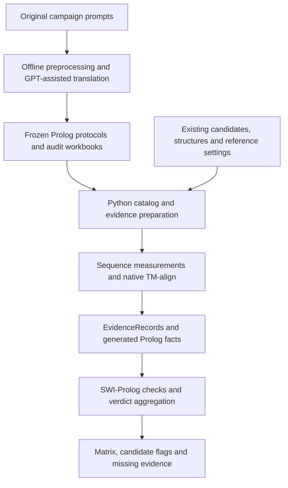

# Gen2Prolog

Gen2Prolog is an MSc research project on natural-language-to-Prolog translation and evidence-based screening of generated protein candidates. It connects source requirements, computational observations and SWI-Prolog verdicts so that each decision can be inspected.

**[Download the complete research package](https://github.com/saharaty/Gen2Prolog/releases/download/research-1.0.2/Gen2Prolog_Research_1.0.2.tar.xz)** · **[Research release and checks](https://github.com/saharaty/Gen2Prolog/releases/tag/research-1.0.2)** · [Attribution and licensing](LICENSES.md)

The complete source, datasets, protocols, tests, evidence and saved results are distributed together in the release archive. This repository's main branch provides the project overview and distribution information. Extract the archive to browse the complete project and follow the relative links in its documentation.

## Research scope

| Study | Method | Archived evidence |
|---|---|---|
| Phase 1 — general English-to-Prolog translation | Four LLM configurations and four prompting strategies, using individual sentences and complete Talk2Prolog scenarios | Code, prompt templates, model outputs, reference-agreement scores and Prolog execution diagnostics |
| Phase 2 — protein-candidate screening | Frozen target-specific protocols connected to existing sequences, structures and computational evidence | EvidenceRecords, real SWI-Prolog verdicts, candidate flags, tests and reproduction receipts |

The biological protocols were prepared offline through preprocessing and GPT-assisted translation. Recovered instructions and audit workbooks preserve source mappings and interpretation decisions. The extent of independent human semantic review remains unverified. Screening starts from the frozen protocols and existing candidates.

Phase 1 error-aware prompting uses fixed wrong/right examples. Its API retry resends the same messages after an error. The runner does not feed verifier judgments into an iterative translation-repair loop. Exact match measures agreement with reference encodings and cannot establish semantic correctness by itself.

## Recorded results

The frozen screening experiment uses 30 published Mythos Preview single-target candidates per target. Original sequences are preserved.

| Target | Candidates | Conditional structural flags | Flagged source ranks |
|---|---:|---:|---|
| MBP | 30 | 2 | 17, 20 |
| 15-PGDH | 30 | 3 | 8, 11, 17 |
| VEGF-A | 30 | 0 | — |
| Mature GDF-8 | 30 | 0 | — |
| **Total** | **120** | **5** | |

| Requirement assessment | Rows |
|---|---:|
| `NO_VIOLATION_DETECTED` | 240 |
| Conditional `VIOLATION_DETECTED` | 5 |
| `UNKNOWN` | 5,065 |
| **Total** | **5,310** |

Decision coverage is **245 / 5,310 = 4.61%**. All 120 candidates retain unresolved assessments and require review. The four protocols contain 1,588 represented units, including definitions, context and workflow material. Of these, 177 protocol–ID pairs enter the candidate matrix, and 16 IDs reached scoped requirement-specific evaluation.

The five flags depend on **candidate-length TM-score normalization**. Reference-length normalization produces zero flags, and strict-source interpretation retains uncertainty. Target reference chains come from published rank-01 predicted complexes. Their exact eligibility as campaign-designated novelty references remains unresolved.

The experiment establishes neither experimental binding nor measured laboratory cost savings. Missing evidence and unsupported checks remain UNKNOWN.

## Download and reproduce

The verified environment is **Apple silicon macOS, Python 3.14.6 and SWI-Prolog 10.0.2**. The wrapper requires Python 3.10 or later. Full recomputation uses the packaged Apple silicon TM-align and cif2pdb executables. Cross-platform numerical equivalence has not been verified.

Install Python and SWI-Prolog, then download and extract the research package:

```sh
download_dir="$(mktemp -d)"
curl -L --fail \
  https://github.com/saharaty/Gen2Prolog/releases/download/research-1.0.2/Gen2Prolog_Research_1.0.2.tar.xz \
  -o "$download_dir/Gen2Prolog_Research_1.0.2.tar.xz"
tar -xJf "$download_dir/Gen2Prolog_Research_1.0.2.tar.xz" -C "$download_dir"
cd "$download_dir/Gen2Prolog"
export PYTHONDONTWRITEBYTECODE=1
runtime="$PWD/01_source_code/Gen2Prolog_Reproducible_1.0.2"
python3 -B "$runtime/verify_package.py"
research_runs="$(mktemp -d)"
python3 -B 10_reproducibility/compare_replay.py "$runtime" "$research_runs/replay"
```

Replay loads archived evidence, invokes real SWI-Prolog and compares all 5,310 assessments against the saved baseline. It writes a `comparison.json` receipt in the new output directory.

To regenerate native measurements, evidence and verdicts on the verified platform, continue in the same terminal:

```sh
python3 -B "$runtime/reproduce.py" full --output "$research_runs/full"
```

Both screening modes use local files and require no paid API calls. Fresh historical LLM runs require separate credentials and incur provider costs.

The release archive's SHA-256 is:

```text
1e916a22cbc074151015272f20e066105306a959cfb8df30f3b23f85c9f8d662
```

## Inspect the pipeline



Python validates inputs, routes supported checks, evaluates supported applicability conditions and prepares evidence. SWI-Prolog evaluates the supplied rules and aggregates supported findings. Runtime routing uses fixed catalog mappings and supplied evidence. There is no RAG retrieval stage.

| Verdict | Meaning within the assessed scope |
|---|---|
| `VIOLATION_DETECTED` | Evidence meets an encoded violation condition under its active interpretation |
| `NO_VIOLATION_DETECTED` | The scoped check supports a non-violation |
| `UNKNOWN` | Evidence, applicability, implementation or decision settings remain insufficient |
| `NOT_APPLICABLE` | Applicability evidence establishes that the requirement does not apply |

After extraction, open `01_source_code/Gen2Prolog_Reproducible_1.0.2/Start_Here.html`. The walkthrough follows MBP rank 17 through its original prompt, protocol, raw measurements, evidence and all three structural interpretations.

## Package contents

| Folder | Contents |
|---|---|
| `01_source_code/` | Frozen runtime, native sources, Phase 1 benchmark code and outputs |
| `02_configuration/` | Configuration and binding guide |
| `03_external_data/` | Published input data guide |
| `04_original_prompts/` | Campaign specification guide |
| `05_reviewed_prolog_protocols/` | Frozen protocol guide |
| `06_derived_data/` | Preprocessed text and intermediate-data guide |
| `07_generated_results/` | Matrices, flags and evidence guide |
| `08_experiment_logs/` | Archived integrity and reproduction receipts |
| `09_provenance/` | Translation instructions, workbooks, mappings and classification records |
| `10_reproducibility/` | Saved-result comparison utility |
| `11_documentation/` | Runtime component and format documentation |

Historical classification tables propose evidence actions. They are separate from the Python catalog used at runtime. The package's `UNRESOLVED_PROVENANCE.md` describes the remaining translation, applicability and reference limitations.

## Tests and integrity

From the extracted project, after defining `runtime` as above:

```sh
swipl -q -s "$runtime/system/tests/fixtures/verifier_regressions.pl" \
  -g 'run_tests,halt' -t 'halt(1)'
(
  cd "$runtime/system"
  python3 -B -m unittest discover -s tests -v
)
```

The archived Python suite reports 116 passing tests and took about 15 minutes in its recorded environment. This publication preparation verified all 3,607 frozen runtime file hashes, source syntax, privacy patterns and six Prolog regressions. It has no fresh completion receipt for the full Python suite.

The package retains saved replay and full-recomputation receipts. Reproduction, agreement on controlled cases and biological accuracy are distinct claims.

## Attribution and licensing

The thesis contribution includes the LLM benchmark extension, evidence-processing and symbolic screening implementation, and software evaluation. Talk2Prolog and its benchmark originate in Laura Fuciarelli's preceding work. Anthropic supplied the original design prompts, candidates, predicted complexes and campaign experiments. External tools retain their authorship and terms.

The included publisher license specifies CC BY 4.0 for campaign data and documentation. The USalign license is retained. A license for the project's own code has not been assigned, and redistribution permission for the historical benchmark remains unverified. See [licensing notes](LICENSES.md). No new reuse permissions are implied by this repository.
